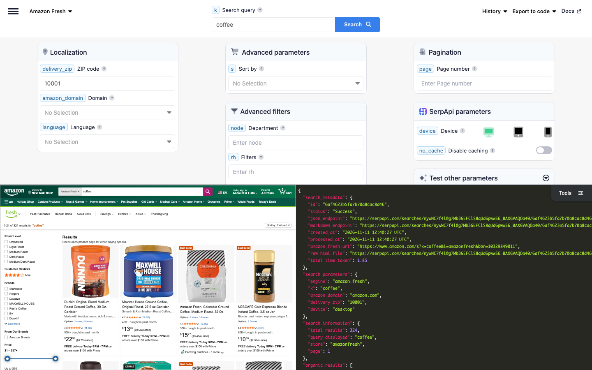

# Amazon Fresh Scraper

Scrape Amazon Fresh grocery search results with SerpApi's Amazon Fresh API. Search groceries by keyword or department for a delivery ZIP code, and get each product's ASIN, title, link, thumbnail, price, unit price, rating, reviews, and delivery times, plus the sponsored brands, departments, and filters on the page.

## How to scrape Amazon Fresh search results

Search Amazon Fresh with a simple GET request:

```text
https://serpapi.com/search?engine=amazon_fresh&k=coffee&delivery_zip=10001&api_key=SERPAPI_API_KEY
```

- `k` is the search query: anything you'd use in a regular Amazon Fresh search. Use `node` with a department ID instead to browse a department, e.g., `16318981` for Fresh Fruits.
- `delivery_zip` is the ZIP or postal code of the delivery location, e.g., `10001` in New York. It's required, because Amazon Fresh shows different products, prices, and delivery times for each location.
- `api_key` is your SerpApi API key. Replace `SERPAPI_API_KEY` with it.
- `amazon_domain` sets the Amazon marketplace: `amazon.com` (default), `amazon.co.uk`, `amazon.co.jp`, `amazon.it`, or `amazon.es`. Use a postal code from the same country, e.g., `EC1A 1BB` on `amazon.co.uk`.
- `s` sorts the products, e.g., by price, customer reviews, or newest arrivals.
- `rh` filters the products with the `rh` values in `filters` from a previous response, e.g., `p_n_program_participation:17428820011` for SNAP EBT Eligible.
- `page` gets the next pages of results.

Amazon Fresh delivers only in some areas. For a ZIP code outside them, the response has no products and the error "Amazon Fresh hasn't returned any results for this query."

[Register at SerpApi](https://serpapi.com?utm_source=github_amazon_fresh_scraper) to get your API key, and keep it private.

### Playground

Try the request live in the [SerpApi Playground](https://serpapi.com/playground?engine=amazon_fresh&k=coffee&delivery_zip=10001&utm_source=github_amazon_fresh_scraper).

[](https://serpapi.com/playground?engine=amazon_fresh&k=coffee&delivery_zip=10001&utm_source=github_amazon_fresh_scraper)

## Code examples

The code examples read your API key from the `SERPAPI_API_KEY` environment variable:

```bash
export SERPAPI_API_KEY="SERPAPI_API_KEY"
```

Each example searches Amazon Fresh for coffee delivered to ZIP code 10001 and prints the position, title, and price of each product.

### curl integration

Send the request with curl, which prints the full JSON response:

```bash
curl --get https://serpapi.com/search \
 --data-urlencode engine="amazon_fresh" \
 --data-urlencode k="coffee" \
 --data-urlencode delivery_zip="10001" \
 --data-urlencode api_key="$SERPAPI_API_KEY"
```

### JavaScript integration

Install the [SerpApi JavaScript library](https://github.com/serpapi/serpapi-javascript) and set your project to use ES modules:

```bash
npm install serpapi
npm pkg set type=module
```

Create an `index.js` file:

```javascript
import { getJson } from "serpapi";

const results = await getJson({
  engine: "amazon_fresh",
  api_key: process.env.SERPAPI_API_KEY,
  k: "coffee",
  delivery_zip: "10001",
});

for (const product of results.organic_results ?? []) {
  console.log(product.position, product.title, product.price);
}
```

Run it with `node index.js`.

### Python integration

Install the [SerpApi Python library](https://github.com/serpapi/serpapi-python):

```bash
pip install serpapi
```

Create a `main.py` file:

```python
import os
import serpapi

client = serpapi.Client(api_key=os.getenv("SERPAPI_API_KEY"))
results = client.search({
    "engine": "amazon_fresh",
    "k": "coffee",
    "delivery_zip": "10001",
})

for product in results.get("organic_results", []):
    print(product["position"], product["title"], product.get("price"))
```

Run it with `python main.py`.

### Ruby integration

Install the [SerpApi Ruby library](https://github.com/serpapi/serpapi-ruby):

```bash
gem install serpapi
```

Create a `main.rb` file:

```ruby
require "serpapi"

client = SerpApi::Client.new(engine: "amazon_fresh", api_key: ENV.fetch("SERPAPI_API_KEY"))
results = client.search(k: "coffee", delivery_zip: "10001")

results.fetch(:organic_results, []).each do |product|
  puts "#{product[:position]} #{product[:title]} #{product[:price]}"
end

client.close
```

Run it with `ruby main.rb`.

### PHP integration

Install the [SerpApi PHP library](https://github.com/serpapi/serpapi-php):

```bash
composer require serpapi/serpapi-php
```

Create an `index.php` file:

```php
<?php
require 'vendor/autoload.php';

use SerpApi\Client;

$client = new Client(getenv('SERPAPI_API_KEY'), 'amazon_fresh');
$results = $client->search([
  'k' => 'coffee',
  'delivery_zip' => '10001',
]);

foreach ($results->organic_results ?? [] as $product) {
  echo $product->position . ' ' . $product->title . ' ' . ($product->price ?? '') . PHP_EOL;
}
```

Run it with `php index.php`.

### Go integration

Create a Go module and install the [SerpApi Go library](https://github.com/serpapi/serpapi-golang):

```bash
go mod init example.com/fresh
go get github.com/serpapi/serpapi-golang
```

Create a `main.go` file:

```go
package main

import (
	"fmt"
	"os"

	"github.com/serpapi/serpapi-golang"
)

func main() {
	setting := serpapi.NewSerpApiClientSetting(os.Getenv("SERPAPI_API_KEY"))
	setting.Engine = "amazon_fresh"
	client := serpapi.NewClient(setting)

	results, err := client.Search(map[string]string{
		"k":            "coffee",
		"delivery_zip": "10001",
	})
	if err != nil {
		panic(err)
	}

	organicResults, _ := results["organic_results"].([]interface{})
	for _, item := range organicResults {
		product := item.(map[string]interface{})
		fmt.Println(product["position"], product["title"], product["price"])
	}
}
```

Run it with `go run .`.

### Rust integration

Create a Cargo project and add the [SerpApi Rust library](https://github.com/serpapi/serpapi-rust) and Tokio:

```bash
cargo new fresh && cd fresh
cargo add serpapi tokio --features tokio/full
```

Replace `src/main.rs` with:

```rust
use serpapi::serpapi::Client;
use std::collections::HashMap;
use std::env;

#[tokio::main]
async fn main() -> Result<(), Box<dyn std::error::Error>> {
    let mut default = HashMap::new();
    default.insert("api_key".to_string(), env::var("SERPAPI_API_KEY")?);
    default.insert("engine".to_string(), "amazon_fresh".to_string());
    let client = Client::new(default)?;

    let mut parameter = HashMap::new();
    parameter.insert("k".to_string(), "coffee".to_string());
    parameter.insert("delivery_zip".to_string(), "10001".to_string());

    let results = client.search(parameter).await?;
    if let Some(organic_results) = results["organic_results"].as_array() {
        for product in organic_results {
            println!(
                "{} {} {}",
                product["position"],
                product["title"].as_str().unwrap_or_default(),
                product["price"].as_str().unwrap_or_default()
            );
        }
    }
    Ok(())
}
```

Run it with `cargo run`.

### Other programming languages

Official libraries are also available for [Java](https://github.com/serpapi/serpapi-java), [.NET](https://github.com/serpapi/serpapi-dotnet), [Swift](https://github.com/serpapi/serpapi-swift), and [C++](https://github.com/serpapi/serpapi-cpp). See [SerpApi integrations](https://serpapi.com/integrations?utm_source=github_amazon_fresh_scraper) for setup guides, or use a simple GET request from any programming language.

### Errors

Failed requests return an HTTP error status and a JSON body with an `error` message. The most common are `401` for an invalid API key, `400` for a missing required parameter such as `delivery_zip`, and `429` when you exceed your hourly throughput limit or run out of searches. See [API status and error codes](https://serpapi.com/api-status-and-error-codes?utm_source=github_amazon_fresh_scraper) for the full list.

A search without products, e.g., for a ZIP code outside the Amazon Fresh delivery area, still returns `200`, with `search_metadata.status` set to `Success` and an `error` message, so check for `error` before reading `organic_results`.

## Output formats: JSON and Markdown

Choose structured JSON for applications or Markdown for LLMs and AI agents:

- JSON is the default output and is useful when you need individual result fields.
- Add `output=md` to receive Markdown instead, which is more token-efficient.

Markdown is plain text, not JSON: YAML front matter with the search metadata, followed by the search information, tables of the products and sponsored brands, a table for each group of filters, and a link to the next page. Read the response body as text instead of parsing it.

| Client | Markdown request |
|--------|------------------|
| curl | `--data-urlencode output="md"` |
| Python | `client.search({..., "output": "md"})` |
| PHP | `$client->md([...])` |
| Go | `client.Md(map[string]string{...})` |
| Rust | `client.md(parameter).await?` |

If your SDK doesn't have a Markdown helper yet, send a plain HTTP request with `output=md` and read the body as text. Learn more about [Markdown output](https://serpapi.com/markdown-output?utm_source=github_amazon_fresh_scraper).

## Amazon Fresh API parameters

See the [Amazon Fresh API documentation](https://serpapi.com/amazon-fresh-api?utm_source=github_amazon_fresh_scraper) for more details.

| Name | Description | Requirement |
|------|-------------|-------------|
| **Search query** | | |
| `k` | The search query: anything you'd use in a regular Amazon Fresh search (e.g., `coffee`). Can't be used with `node`. | Optional |
| **Localization** | | |
| `delivery_zip` | The ZIP or postal code of the delivery location (e.g., `10001` on amazon.com, `EC1A 1BB` on amazon.co.uk, or `100-0001` on amazon.co.jp). Amazon Fresh shows the products, prices, and delivery options available at that location. ZIP+4 codes aren't supported. | Required |
| `amazon_domain` | The Amazon domain to use: `amazon.com` (default), `amazon.co.uk`, `amazon.co.jp`, `amazon.it`, or `amazon.es`, where Amazon Fresh is available. | Optional |
| `language` | The language of the results, as a `<language>_<REGION>` locale (e.g., `en_US` or `es_US` on amazon.com, `ja_JP` on amazon.co.jp). See [Amazon languages](https://serpapi.com/amazon-languages?utm_source=github_amazon_fresh_scraper) for supported languages. | Optional |
| **Advanced parameters** | | |
| `s` | The sort order: `relevanceblender` for Featured (default), `price-asc-rank` for Price: Low to High, `price-desc-rank` for Price: High to Low, `review-rank` for Avg. Customer Review, `date-desc-rank` for Newest Arrivals, or `exact-aware-popularity-rank` for Best Sellers. | Optional |
| **Advanced filters** | | |
| `node` | The ID of an Amazon Fresh department to browse instead of searching (e.g., `16318981` for Fresh Fruits on amazon.com). Department IDs are the `n:` values in `filters.department[].rh` (e.g., `n:16318981`). To switch departments while browsing, change `node` or follow the department's `serpapi_link`, as Amazon ignores departments in `rh` while `node` is set. Can't be used with `k`. | Optional |
| `rh` | Filters as comma-separated `key:value` pairs (e.g., `n:16318981,p_n_program_participation:17428820011` for SNAP EBT Eligible products in the Fresh Fruits department on amazon.com). Use `p_36:<min>-<max>` for a price range, with prices multiplied by 100 (e.g., `p_36:300-500` for $3.00 to $5.00). The available filters are in `filters` of the response. | Optional |
| `dc` | Set to `true` to exclude results from an auto-corrected query when the original query is misspelled, or `false` to include them (default). | Optional |
| **Pagination** | | |
| `page` | The page number (e.g., `1` for the first page, `2` for the second). Defaults to `1`. | Optional |
| **SerpApi parameters** | | |
| `engine` | Set to `amazon_fresh`. | Required |
| `api_key` | Your private SerpApi API key. | Required |
| `device` | Set to `desktop` (default), `tablet`, or `mobile`. | Optional |
| `no_cache` | Set to `true` to request fresh results instead of using the one-hour cache. Can't be combined with `async`. | Optional |
| `async` | Set to `true` for later retrieval through the [Searches Archive API](https://serpapi.com/search-archive-api?utm_source=github_amazon_fresh_scraper). Can't be combined with `no_cache` or used with Ludicrous Speed enabled. | Optional |
| `zero_trace` | Enterprise only. Set to `true` to skip storing search parameters, files, and metadata on SerpApi servers. | Optional |
| `output` | Set to `json` (default), `html` for the raw HTML retrieved, or `md` for Markdown. | Optional |
| `json_restrictor` | Limit the JSON response to the fields you need. See the [JSON Restrictor](https://serpapi.com/json-restrictor?utm_source=github_amazon_fresh_scraper) documentation. | Optional |

## Available data on Amazon Fresh search results (JSON response)

Each item in `organic_results` is a product available for delivery to `delivery_zip`. The page can also include `sponsored_brands`, and `filters` to refine the search, with the Amazon Fresh departments in `filters.department`. The field guides below describe the possible fields and their types; they aren't literal API responses.

### What you get depends on the product

Some fields appear only when Amazon Fresh shows them:

| Product | Fields |
|---------|--------|
| A product on sale | `old_price` and `extracted_old_price` with the price before the discount, and the discount in `offers`, e.g., 19% off |
| A best seller | `badges`, e.g., Best Seller in Ground Coffee |
| A product in several sizes or flavors | `options`, e.g., 2 sizes, 3 flavors, and `options_link` |
| A product with a multi-buy offer | `offers`, e.g., Any 2 for £4.00 on amazon.co.uk |
| A product with sustainability certifications | `climate_pledge_friendly` and `sustainability_features`, e.g., certified by Rainforest Alliance |
| A product with a country of origin label | `origin_country`, e.g., Made in Italy |
| An out-of-stock product | `stock`, e.g., Out of Stock |

Each product has an `asin` and a `serpapi_link` to its details with the [Amazon Product API](https://serpapi.com/amazon-product-api?utm_source=github_amazon_fresh_scraper) for the same `delivery_zip`. Prices are returned as displayed, e.g., $22.96, and as numbers in the matching `extracted_` fields. Prices, stock, and delivery times depend on `delivery_zip`.

To get only SNAP EBT eligible products, apply the `rh` value in `filters.snap_ebt`. To get the next page, increase `page` or follow `serpapi_pagination.next`.

### Organic results

Each product in `organic_results` can include these fields:

```json
{
  "organic_results": [
    {
      "position": "Integer - Position of the product on the page",
      "asin": "String - Amazon Standard Identification Number (ASIN) of the product, e.g., B07C1YFV6D",
      "title": "String - Title of the product",
      "link": "String - Link to the product on Amazon",
      "link_clean": "String - Link to the product on Amazon, without tracking parameters",
      "serpapi_link": "String - SerpApi link to the details of the product with the Amazon Product API, for the same delivery_zip",
      "thumbnail": "String - Link to the image of the product",
      "badges": "Array[String] - Badges of the product, e.g., Best Seller in Ground Coffee",
      "options": "String - Available options, e.g., 2 sizes, 3 flavors",
      "options_link": "String - Link to the options of the product",
      "rating": "Float - Average rating out of 5, e.g., 4.8",
      "reviews": "Integer - Number of reviews, e.g., 11800",
      "bought_last_month": "String - Purchases in the past month, e.g., 50K+ bought in past month",
      "price": "String - Price, as displayed, e.g., $22.96",
      "extracted_price": "Float - Price as a number, e.g., 22.96",
      "price_unit": "String - Price per unit, as displayed, e.g., $0.77/ounce",
      "extracted_price_unit": "Float - Price per unit as a number, e.g., 0.77",
      "old_price": "String - Price before the discount, as displayed, e.g., $6.48",
      "extracted_old_price": "Float - Price before the discount as a number",
      "offers": "Array[String] - Discounts and other offers, e.g., 8% off or Any 2 for £4.00",
      "stock": "String - Stock status, e.g., Out of Stock",
      "delivery": "Array[String] - Delivery options for the delivery_zip, e.g., FREE delivery Today 5 PM - 7 PM on orders over $100 with Prime",
      "climate_pledge_friendly": "Boolean - Whether the product is Climate Pledge Friendly",
      "sustainability_features": [
        {
          "position": "Integer - Position of the feature",
          "name": "String - Name of the feature, e.g., Farming practices",
          "snippet": "String - Description of the feature",
          "thumbnail": "String - Link to the icon of the certification",
          "certified_by": "String - Certifying organization, e.g., Rainforest Alliance",
          "certified_info": "String - Description of the certification"
        }
      ],
      "origin_country": {
        "name": "String - Country of origin, e.g., Made in Italy",
        "link": "String - Link to the Amazon page of products from the country",
        "thumbnail": "String - Link to the icon of the country"
      },
      "purchase_options": [
        {
          "primary_price": "String - Price, as displayed, e.g., $5.97",
          "extracted_primary_price": "Float - Price as a number",
          "old_primary_price": "String - Price before the discount, as displayed, e.g., $6.48",
          "extracted_old_primary_price": "Float - Price before the discount as a number",
          "secondary_price": "String - Discount or offer shown next to the price, e.g., 8% off",
          "extracted_secondary_price": "Number - First number in secondary_price, e.g., 8"
        }
      ]
    }
  ]
}
```

`purchase_options` is returned for every product and repeats its prices. `secondary_price` isn't a second price here: it's the discount or offer shown next to the price.

### Sponsored brands

`sponsored_brands` lists the brands advertised for the search:

```json
{
  "sponsored_brands": {
    "title": "String - Title of the section, e.g., Brands related to your search",
    "brands": [
      {
        "position": "Integer - Position of the brand",
        "name": "String - Name of the brand, if shown, e.g., Kicking Horse Coffee",
        "headline": "String - Headline of the ad, e.g., The Bean, The Whole Bean and Nothing But The Bean",
        "image": "String - Link to the image of the ad",
        "logo": "String - Link to the logo of the brand",
        "link": "String - Link of the ad on Amazon"
      }
    ]
  }
}
```

Some searches can also return `video_results`, product videos with their `products`, as in the [Amazon Search API](https://serpapi.com/amazon-search-api?utm_source=github_amazon_fresh_scraper).

### Departments and filters

`filters` lists the filters available for the search with their `rh` value for the `rh` parameter. `filters.department` lists the Amazon Fresh departments, with the department ID for `node` after `n:` in their `rh`:

```json
{
  "filters": {
    "department": [
      {
        "position": "Integer - Position of the department",
        "name": "String - Name of the department, e.g., Fresh Fruits",
        "rh": "String - Value for the rh parameter, e.g., n:16318981",
        "link": "String - Link to the department on Amazon",
        "serpapi_link": "String - SerpApi link to the department, for the same delivery_zip",
        "used": "Boolean - Whether it's the current department"
      }
    ],
    "brands": [
      {
        "position": "Integer - Position of the filter in its group",
        "name": "String - Name of the filter, e.g., Starbucks",
        "rh": "String - Value for the rh parameter, e.g., p_123:660401",
        "link": "String - Link to the filtered search on Amazon",
        "serpapi_link": "String - SerpApi link to the filtered search, for the same delivery_zip",
        "used": "Boolean - Whether the filter is applied"
      }
    ]
  }
}
```

`filters` has a key for each group of filters on the page, e.g., `department`, `brands`, `customer_reviews`, `deals_discounts`, `snap_ebt`, and `sustainability_features`, plus groups that depend on the search, such as `roast_level` for coffee. Join several `rh` values with commas to combine filters. An applied filter has `used` set to `true`, and its `serpapi_link` removes it. The current department has no `link` or `serpapi_link`, and has `used` set to `true` when you choose it with `node` or `rh`. While you browse with `node`, the `serpapi_link` of each department, filter, and page keeps browsing with `node`.

### Search information and pagination

`search_information` describes the search, and `serpapi_pagination` links to the other pages:

```json
{
  "search_information": {
    "total_results": "Integer - Number of results shown by Amazon, e.g., 324",
    "query_displayed": "String - Query shown by Amazon when you search with k, e.g., coffee",
    "store": "String - Amazon store of the search, amazonfresh",
    "page": "Integer - Current page"
  },
  "serpapi_pagination": {
    "current": "Integer - Current page",
    "previous": "String - SerpApi link to the previous page",
    "next": "String - SerpApi link to the next page"
  }
}
```

## AI agents and no-code

### MCP

Give AI agents and assistants an Amazon Fresh grocery search tool with the hosted [SerpApi MCP server](https://github.com/serpapi/serpapi-mcp) at `https://mcp.serpapi.com/mcp`.

Claude Code:

```bash
claude mcp add --transport http serpapi https://mcp.serpapi.com/mcp --header "Authorization: Bearer $SERPAPI_API_KEY"
```

Codex, which reads the key from `SERPAPI_API_KEY`:

```bash
codex mcp add serpapi --url https://mcp.serpapi.com/mcp --bearer-token-env-var SERPAPI_API_KEY
```

Other MCP clients:

```json
{
  "mcpServers": {
    "serpapi": {
      "type": "http",
      "url": "https://mcp.serpapi.com/SERPAPI_API_KEY/mcp"
    }
  }
}
```

The server's engine catalog includes the `amazon_fresh` engine, and its `serpapi://engines/amazon_fresh` resource describes the parameters. Ask your agent to search Amazon Fresh with the `amazon_fresh` engine and a `delivery_zip`. The resulting tool call looks like this:

```json
{
  "name": "search",
  "arguments": {
    "params": {
      "engine": "amazon_fresh",
      "k": "coffee",
      "delivery_zip": "10001"
    }
  }
}
```

See the [MCP integration guide](https://serpapi.com/integrations/mcp?utm_source=github_amazon_fresh_scraper) for more clients and self-hosting.

### CLI

Search Amazon Fresh from your terminal or from AI agent workflows with the [SerpApi CLI](https://github.com/serpapi/serpapi-cli):

```bash
brew tap serpapi/homebrew-tap
brew install serpapi-cli
```

The CLI picks up `SERPAPI_API_KEY` from your environment. You can also run `serpapi login` to save a key.

```bash
serpapi search engine=amazon_fresh k=coffee delivery_zip=10001
serpapi search engine=amazon_fresh k=coffee delivery_zip=10001 --fields "organic_results[].{title, price, price_unit}"
serpapi search engine=amazon_fresh k=coffee delivery_zip=10001 output=md
```

### No-code tools

Use SerpApi APIs without writing code:

- [NoCodeSerpApi](https://nocodeserpapi.com/)
- [SerpApi with n8n](https://serpapi.com/blog/tag/n8n/)
- [SerpApi with Make](https://serpapi.com/blog/tag/make/)
- [More integrations](https://github.com/serpapi/serpapi-integrations/)

## Use cases

- Track the prices, unit prices, and discounts of groceries over time.
- Compare grocery prices and availability across ZIP codes and Amazon Fresh marketplaces.
- Monitor where your products and your competitors' products rank for a grocery search, with their ratings, reviews, and purchases in the past month.
- Research the assortment of an Amazon Fresh department in an area, e.g., which brands it carries, with `node`.
- Find SNAP EBT eligible or Climate Pledge Friendly groceries with `rh` filters.
- Give AI agents, RAG pipelines, and meal planning apps a grocery search tool.

## Related scrapers

- [Amazon Scraper](https://github.com/serpapi/amazon-scraper): Amazon search results
- [Amazon Product Scraper](https://github.com/serpapi/amazon-product-scraper): product pages by ASIN
- [Google Shopping Scraper](https://github.com/serpapi/google-shopping-scraper): products and prices from Google Shopping

## Contact

Feel free to reach out at [contact@serpapi.com](mailto:contact@serpapi.com).
